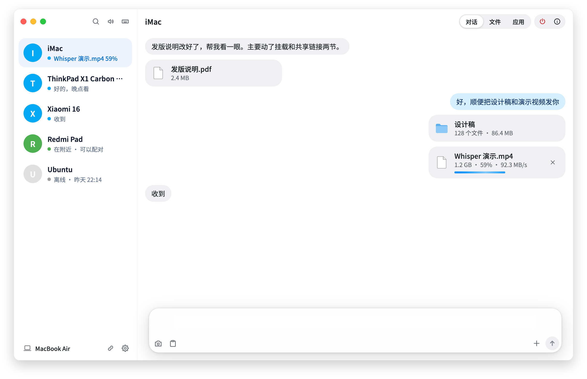
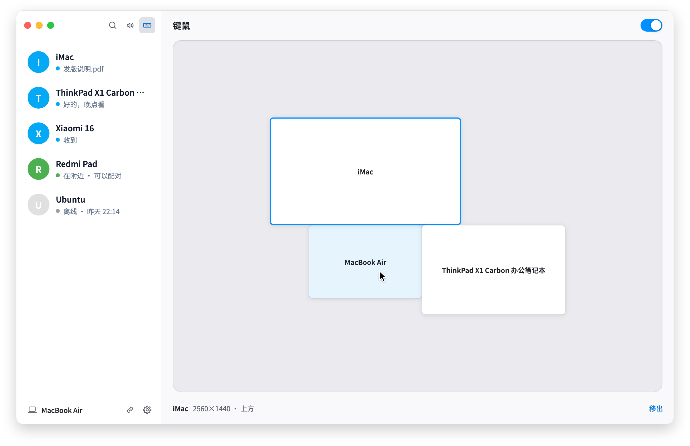
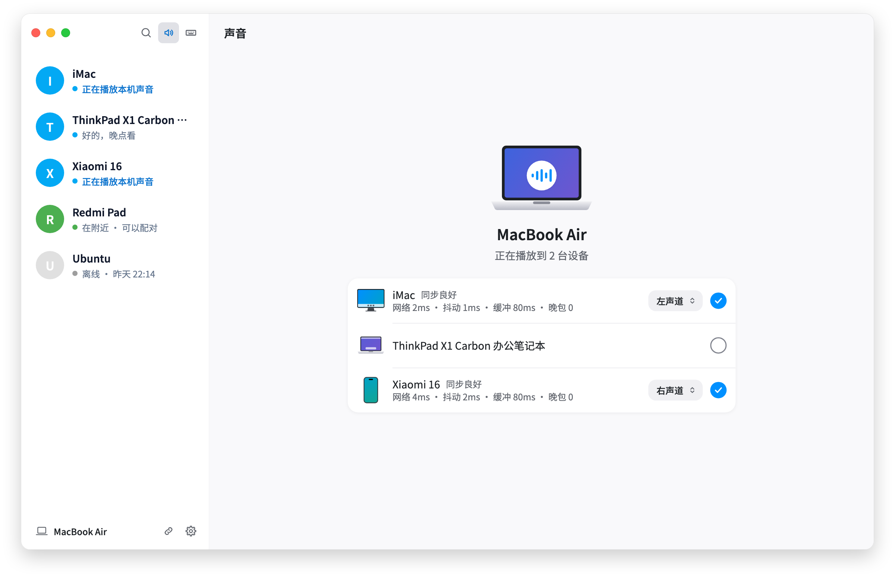

<div align="center">


# Whisper

在自己的电脑和手机之间，直接传文本、文件、剪贴板、声音、键鼠和窗口。

LAN file transfer, software KVM, clipboard sync, audio and window streaming between your computers and phones. Free, open source and end-to-end encrypted.

[](https://github.com/lawnvi/whisper/releases)
[](https://github.com/lawnvi/whisper/releases)

[](./LICENSE)

[官网](https://whisper-lan.github.io/zh) · [国内镜像](https://whisper.127014.xyz/zh) · [下载](https://github.com/lawnvi/whisper/releases) · [使用指南](docs/user-guide.md) · [排障指南](docs/troubleshooting.md) · [English](./README_en.md)

</div>



Whisper 是一个局域网协作工具。设备配对后通过加密通道直接相连，数据不经过任何服务器，不用注册账号，断了外网也能用。一台设备可以同时连接多台电脑和手机。

> 本项目与 OpenAI 的 Whisper 语音识别模型无关。

## 功能

| 功能 | 说明 |
| --- | --- |
| **文本与文件** | 像聊天一样发文字、文件和整个文件夹，断线可续传 |
| **对方的文件** | 浏览、拷贝、修改，或者挂进访达和资源管理器当本机磁盘用 |
| **共享链接** | 对方没装 Whisper 也能收：发个链接，用浏览器下载 |
| **键鼠共享** | 软件 KVM：一套键盘鼠标用多台电脑，指针移到屏幕边缘就过去 |
| **手机控制电脑** | Android 手机当触控板、体感鼠标和键盘 |
| **系统音频** | 把电脑的声音送到一台或多台设备播放 |
| **窗口流转** | 电脑的窗口、安卓手机的应用，在另一台设备上打开并操作 |
| **剪贴板同步** | 在一台设备上复制，到另一台粘贴 |
| **通知转发** | 把 Android 上选定 App 的通知（比如验证码）送到电脑 |

另外还有：从分享菜单、右键菜单或快捷键直接发送，带标注的桌面截图。

实验性功能：接收视频 App 的 DLNA 投屏；唤醒睡着的电脑（要插网线，还没有在真机上验证过）。

<p align="center">
  
  
</p>

## 下载

到 [Releases](https://github.com/lawnvi/whisper/releases) 下载对应平台的安装包，[官网](https://whisper-lan.github.io/zh)会按你的系统选好文件。

| 平台 | 系统要求 | 安装包 |
| --- | --- | --- |
| Android | 7.0 及以上 | `android-arm64-v8a.apk`，不确定选 `android-universal.apk` |
| macOS | 10.15 及以上 | Apple 芯片 `macos-arm64.dmg`，Intel `macos-x86_64.dmg` |
| Windows | 10 / 11，64 位 | `windows-x86_64.exe` |
| Linux | x86_64 | `.deb`、`.rpm` 或 `.AppImage` |

- 安装包没有代码签名。被系统或杀毒软件拦下时，按[排障指南](docs/troubleshooting.md#装不上打不开)里的步骤放行。
- iOS / iPadOS 没有上架 App Store。每次发布附带一个未签名的 `ios-unsigned.ipa`，要用 AltStore、Sideloadly 等工具自己签名安装；它没有经过完整的真机测试。

## 快速开始

1. 在两台设备上安装并打开 Whisper，连到同一个局域网。
2. 在设备列表里点击对方，双方核对并确认配对码。
3. 进入会话开始发送。声音和键鼠的入口在桌面端侧栏顶部。

列表里没有对方时，桌面端点左下角这台设备的名字，手机点加号，扫二维码或输入对方的 IP 和端口（默认 `10002`）。

两个值得记住的快捷键：

| 作用 | Windows / Linux | macOS |
| --- | --- | --- |
| 发送剪贴板里的内容 | `Ctrl+Alt+V` | `Cmd+Option+V` |
| 退出键鼠共享 | `Ctrl+Alt+Esc` | `Control+Option+Esc` |

每项功能怎么用，见[使用指南](docs/user-guide.md)；装不上、连不上或卡顿，见[排障指南](docs/troubleshooting.md)。

## 平台支持

| 功能 | Android | macOS | Windows | Linux |
| --- | :---: | :---: | :---: | :---: |
| 文本与文件 | ✅ | ✅ | ✅ | ✅ |
| 发送文件夹 | 仅接收 | ✅ | ✅ | ✅ |
| 浏览文件 | ✅ | ✅ | ✅ | ✅ |
| 挂载对方的文件 | 只能被挂载 | ✅ | ✅ | 需要 fuse3 |
| 共享链接 | ✅ | ✅ | ✅ | ✅ |
| 键鼠共享 | — | ✅ | ✅ | X11、GNOME 或 KDE Plasma |
| 手机控制电脑 | 控制端 | 被控端 | 被控端 | 被控端，要求同上 |
| 系统音频 | 仅播放 | ✅ | ✅ | ✅ |
| 窗口流转：显示 | ✅ | ✅ | ✅ | ✅ |
| 窗口流转：被流转 | Android 10 及以上 | ✅ | ✅ | GNOME 45+ 或 KDE Plasma 6 |
| 剪贴板同步 | 仅文本，需在前台 | ✅ | ✅ | ✅ |
| 通知转发 | 发送 | 接收 | 接收 | 接收 |
| 桌面截图 | — | ✅ | ✅ | 取决于桌面环境 |
| 电视投屏接收 | — | ✅ | ✅ | ✅ |

Linux 的自动发现依赖 Avahi；视频预览和电视投屏需要 libmpv，窗口流转需要 FFmpeg 4 及以上，缺了它们其他功能照常可用。各桌面环境在 Wayland 下的要求和授权方式，见使用指南的[键鼠共享](docs/user-guide.md#权限与平台限制)和[窗口流转](docs/user-guide.md#被流转的设备)。

## 安全

- 配对后的数据通过 X25519 和 XChaCha20-Poly1305 加密的直连通道传输。
- 局域网发现和连接元数据不加密，本地数据库和收到的文件也不做静态加密。
- 只在局域网内直连，没有公网中继。实现未经独立的密码学审计。
- 键鼠共享面向身边的自有设备，不是无人值守的远程控制方案。

## 参与开发

问题和建议请提 [Issue](https://github.com/lawnvi/whisper/issues/new/choose)，也欢迎 Pull Request。从源码运行需要 Flutter 3.44.9（stable）和目标平台的工具链：

```bash
flutter pub get
flutter run
flutter analyze && flutter test
```

- macOS 请用 `./script/build_and_run.sh`，它会构建、签名并启动应用。
- Linux 还需要 Avahi、PulseAudio 或 PipeWire Pulse、GStreamer、libsecret、keybinder、jsoncpp、libmpv、libepoxy 和 libpipewire-0.3 的开发包。
- 代码约定和提交格式见 [AGENTS.md](AGENTS.md)，各子系统的设计见[文档索引](docs/README.md)。

## License

[MIT](./LICENSE)
