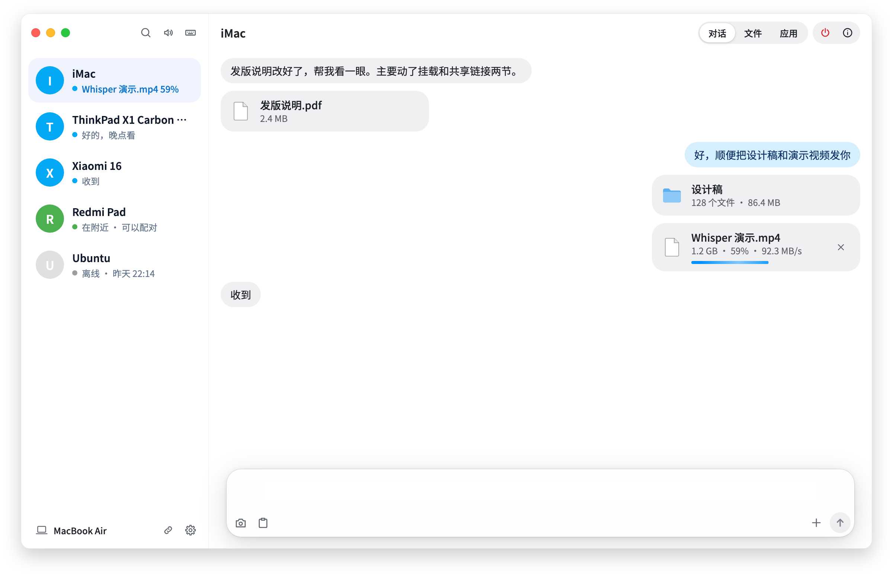
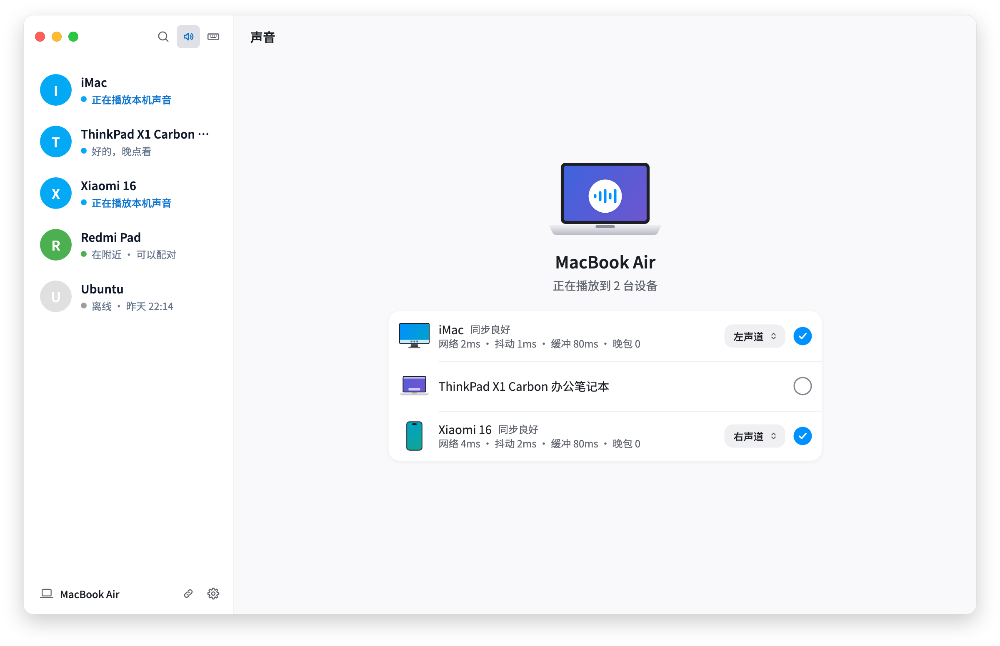
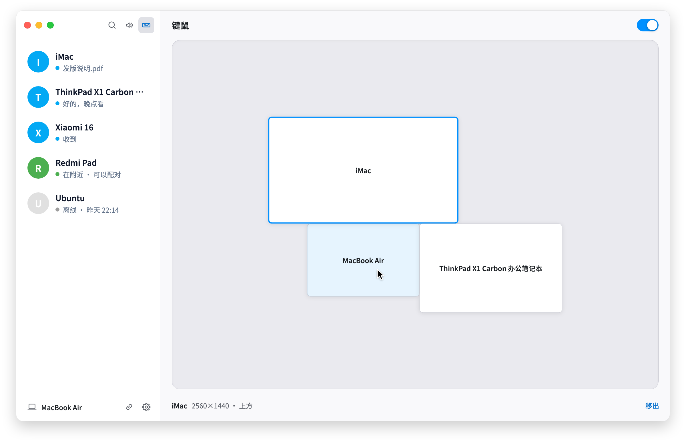

<div align="center">


# Whisper

Move text, files, clipboard, audio, keyboard/mouse input, and app windows directly between your own computers and phones.

[](https://github.com/lawnvi/whisper/releases)
[](https://github.com/lawnvi/whisper/releases)

[](./LICENSE)

[Website](https://whisper-lan.github.io/en) · [China mirror](https://whisper.127014.xyz/zh) · [Download](https://github.com/lawnvi/whisper/releases) · [User guide](docs/user-guide_en.md) · [Troubleshooting](docs/troubleshooting_en.md) · [中文](./README.md)

</div>



Whisper is a LAN collaboration app. Paired devices connect to each other directly over an encrypted channel: no server in between, no account, and it keeps working without internet. One device can stay connected to several computers and phones at once.

> This project is not related to OpenAI's Whisper speech recognition model.

## Features

| Feature | What it does |
| --- | --- |
| **Text and files** | Send text, files and whole folders like chat messages; transfers resume and are verified on arrival. Also from the share sheet, a context menu or a global hotkey |
| **The other device's files** | Browse, copy and edit them, or mount them in Finder, File Explorer or a Linux file manager and use them like a local disk |
| **Share links** | For a device without Whisper: send a link and it downloads in a browser, with an optional password |
| **Keyboard and mouse sharing** | A software KVM: one keyboard and mouse across several computers, switching when the pointer crosses a screen edge. Sleeping computers are woken automatically |
| **Phone controller** | An Android phone as a touchpad, air mouse and keyboard |
| **System audio** | Play a computer's sound on one or more other devices |
| **Window flow** | Open and use a computer's windows or an Android phone's apps on another device |
| **Clipboard sync** | Copy on one device, paste on another |
| **Notification forwarding** | Send chosen Android apps' notifications, such as verification codes, to your computer |

There are also desktop screenshots with markup, and receiving DLNA casts from video apps (experimental).

| Audio sharing | Keyboard and mouse sharing |
| --- | --- |
|  |  |

## Download

Get the installer for your platform from [Releases](https://github.com/lawnvi/whisper/releases); the [website](https://whisper-lan.github.io/en) picks the right file for your system.

| Platform | Requirement | Installer |
| --- | --- | --- |
| Android | 7.0 or later | `android-arm64-v8a.apk` for most phones, `android-universal.apk` if unsure |
| macOS | 10.15 or later | `macos-arm64.dmg` for Apple silicon, `macos-x86_64.dmg` for Intel |
| Windows | 10 / 11, 64-bit | `windows-x86_64.exe` |
| Linux | x86_64 | `.deb`, `.rpm`, or `.AppImage` |

- The installers are not code-signed. If your system or antivirus blocks one, follow the steps in [Troubleshooting](docs/troubleshooting_en.md#it-wont-install-or-open).
- iOS / iPadOS is not on the App Store. Every release includes an unsigned `ios-unsigned.ipa` to sign and install yourself with a tool such as AltStore or Sideloadly; it has not been fully tested on a real device.

## Quick start

1. Install and open Whisper on two devices connected to the same local network.
2. Select the other device in the device list, then check and confirm the pairing code on both sides.
3. Open the conversation and start sending. Sound and keyboard/mouse sharing are at the top of the sidebar on desktop.

If the other device is not listed, select this device's name at the bottom left on desktop, or the plus button on a phone, then scan a QR code or enter the other device's IP address and port (`10002` by default).

Two shortcuts worth remembering:

| Shortcut | What it does |
| --- | --- |
| `Ctrl+Alt+V` (`Cmd+Option+V` on macOS) | Sends what is on the clipboard to the other device |
| `Ctrl+Alt+Esc` (`Control+Option+Esc` on macOS) | Leaves keyboard/mouse sharing and brings the pointer back |

The [user guide](docs/user-guide_en.md) covers every feature; for install, connection or stutter problems, see [Troubleshooting](docs/troubleshooting_en.md).

## Platform support

| Feature | Android | macOS | Windows | Linux |
| --- | :---: | :---: | :---: | :---: |
| Text and files | ✅ | ✅ | ✅ | ✅ |
| Sending folders | Receive only | ✅ | ✅ | ✅ |
| File browsing | ✅ | ✅ | ✅ | ✅ |
| Mounting the other device's files | Can be mounted only | ✅ | ✅ | Needs fuse3 |
| Share links | ✅ | ✅ | ✅ | ✅ |
| Keyboard and mouse sharing | — | ✅ | ✅ | X11, GNOME or KDE Plasma |
| Phone controller | Controls | Controlled | Controlled | Controlled, same as above |
| Wake-on-LAN | — | ✅ | ✅ | ✅ |
| System audio | Playback only | ✅ | ✅ | ✅ |
| Window flow: view | ✅ | ✅ | ✅ | ✅ |
| Window flow: share | Android 10 or later | ✅ | ✅ | GNOME 45+ or KDE Plasma 6 |
| Clipboard sync | Text, foreground only | ✅ | ✅ | ✅ |
| Notification forwarding | Sends | Receives | Receives | Receives |
| Desktop screenshots | — | ✅ | ✅ | Depends on desktop |
| TV casting receiver | — | ✅ | ✅ | ✅ |

On Linux, discovery depends on Avahi; video previews and TV casting need libmpv, and window flow needs FFmpeg 4 or later. Everything else works without them. For what each desktop needs on Wayland and how it asks for permission, see the user guide on [keyboard and mouse sharing](docs/user-guide_en.md#permissions-and-platform-limits) and [window flow](docs/user-guide_en.md#the-device-being-shown).

## Security

- Data between paired devices travels over a direct channel encrypted with X25519 and XChaCha20-Poly1305.
- LAN discovery and connection metadata are not encrypted, and neither are the local database or received files at rest.
- Devices only connect directly on the local network; there is no public relay. The implementation has not had an independent cryptographic audit.
- Keyboard and mouse sharing is meant for your own nearby devices, not for unattended remote control.

## Contributing

Report problems and ideas in an [issue](https://github.com/lawnvi/whisper/issues/new/choose); pull requests are welcome. To run from source you need Flutter 3.44.9 (stable) and the toolchain for your target platform:

```bash
flutter pub get
flutter run
flutter analyze && flutter test
```

- On macOS, use `./script/build_and_run.sh`, which builds, signs, and launches the app.
- Linux also needs the development packages for Avahi, PulseAudio or PipeWire Pulse, GStreamer, libsecret, keybinder, jsoncpp, libmpv, libepoxy, and libpipewire-0.3.
- See [AGENTS.md](AGENTS.md) for code conventions and commit format, and the [documentation index](docs/README.md) for how each subsystem works (in Chinese).

## License

[MIT](./LICENSE)
