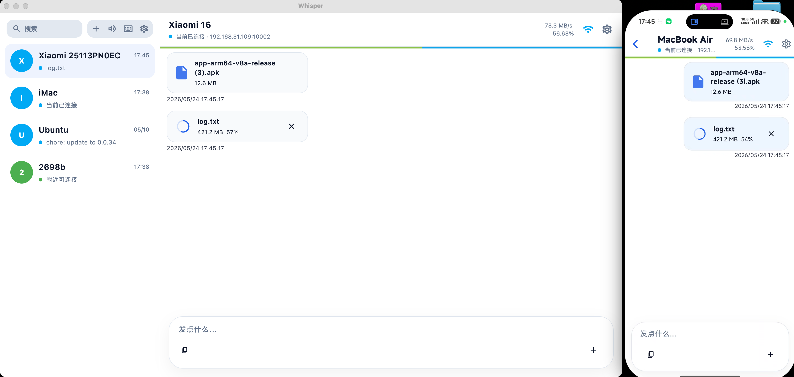
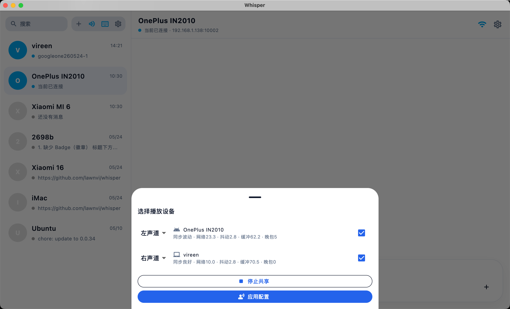
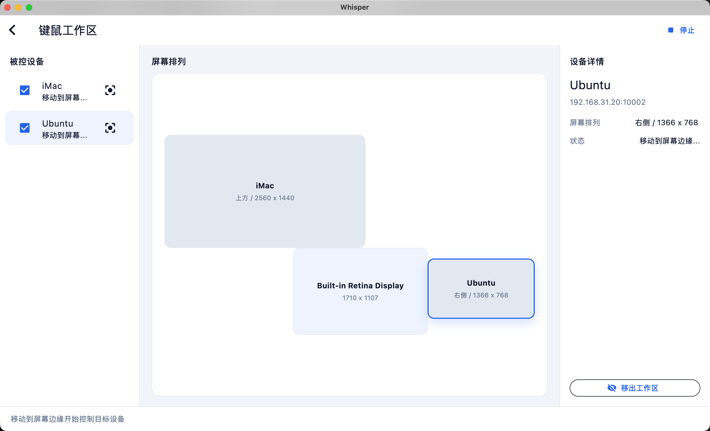

<div align="center">


# Whisper

Move text, files, clipboard, audio, and keyboard/mouse input directly between your own computers and phones.

[](https://github.com/lawnvi/whisper/releases)

[](./LICENSE)

[Website](https://whisper.127014.xyz/en) · [Download](https://github.com/lawnvi/whisper/releases) · [User guide](docs/user-guide_en.md) · [中文](./README.md)

</div>



Whisper is a LAN collaboration app. Paired devices connect to each other directly over an encrypted channel, and your data never passes through a server. One device can stay connected to several computers and phones at once.

> This project is not related to OpenAI's Whisper speech recognition model.

## Features

| Feature | What it does |
| --- | --- |
| **Text and files** | Send them like chat messages; file transfers resume after a disconnect and are verified on arrival |
| **Folders** | Send a whole folder from a desktop without archiving it first; it arrives with the same structure |
| **File browsing** | Browse the other device's files as if in your own file manager, and copy, create, rename, or delete them; the other device approves each time, or always |
| **Mount on this computer** | Show the other device's files as a location in Finder, File Explorer, or your Linux file manager, and open them the usual way (read-only) |
| **Share links** | Give a device without Whisper a link to download files or folders from this one in a browser, optionally with a password |
| **Window flow** | Open this computer's windows, or an Android phone's apps, on a phone, tablet, or another computer and use them there; or send a window to another device |
| **Quick send** | Use the Android share sheet, a desktop context menu, or a global hotkey without opening a conversation |
| **Clipboard sync** | Copy on one device, paste on another (off by default) |
| **Keyboard and mouse sharing** | Use one keyboard and mouse across several computers; move the pointer past a screen edge to switch |
| **Phone controller** | Turn an Android phone into an air mouse, touchpad, and keyboard |
| **System audio sharing** | Play a computer's sound on one or more other devices |
| **Notification forwarding** | Send notifications from chosen Android apps, such as verification codes, to your computer |
| **Desktop screenshots** | Click a window or drag a region and the capture lands on the clipboard |
| **TV casting** | Receive DLNA casts from video apps on your computer (experimental) |

| Audio sharing | Keyboard and mouse sharing |
| --- | --- |
|  |  |

## Download

Get the installer for your platform from the [Releases](https://github.com/lawnvi/whisper/releases) page.

| Platform | Requirement | Which file |
| --- | --- | --- |
| Android | 7.0 or later | `android-arm64-v8a.apk` for most phones, or `android-universal.apk` if unsure |
| macOS | 10.15 or later | `macos-arm64.dmg` for Apple silicon, `macos-x86_64.dmg` for Intel |
| Windows | 10 / 11, 64-bit | `windows-x86_64.exe` |
| Linux | x86_64 | `.deb`, `.rpm`, or `.AppImage` |

iOS / iPadOS: the project has no paid Apple Developer account, so the app is not on the App Store. Every release includes an unsigned `ios-unsigned.ipa` that you can sign with your own Apple ID using a tool such as AltStore or Sideloadly (apps signed with a free Apple ID must be re-signed every 7 days). It has not been fully tested on a real device and may not work, so please report any problems.

## Quick start

1. Install and open Whisper on two devices connected to the same local network.
2. Select the other device in the device list, then check and confirm the pairing code on both sides.
3. Open the conversation and start sending. Keyboard/mouse sharing, audio sharing, and the other tools are in the device tools area on desktop.

> The other device is not listed? Select the QR icon above the device list, then scan its code or enter its IP address and port (`10002` by default).

## Everyday actions

| To do this | Do this |
| --- | --- |
| Send what is on the clipboard | Press `Cmd+Option+V` on macOS, `Ctrl+Alt+V` on Windows / Linux |
| Send from another app | Use the Android share sheet, or the file context menu on desktop |
| Send a folder | On desktop, drop the folder into the conversation, or choose "Folder" from the attachment button |
| Browse the other device's files | Open Device Details at the top right of the conversation and select "Files"; on desktop you can drag files straight into Finder or File Explorer |
| Open the other device's files in the system file manager | Turn on "Mount on this computer" in Device Details; it mounts whenever the device connects, and ejecting it in the system turns the switch off |
| Send files to a device without Whisper | In "Files", right-click a file or folder on this device (long-press on a phone) and choose "Create Share Link…" |
| Use the other device's windows or apps | Select "Flow" in Device Details, then choose a window or app |
| Start keyboard/mouse sharing | Open the workspace, drag the other screen next to this one, and select "Start" |
| Leave keyboard/mouse sharing | Press `Ctrl+Alt+Esc` on the controlling device (`Control+Option+Esc` on macOS) |
| Control a computer from a phone | In the Android conversation, select "Control computer", then the start button at the top |
| Take a screenshot | Use the screenshot button or your shortcut on desktop; `Esc` cancels |

The [user guide](docs/user-guide_en.md) covers every feature in full.

## Platform support

| Feature | Android | macOS | Windows | Linux |
| --- | :---: | :---: | :---: | :---: |
| Text and files | ✅ | ✅ | ✅ | ✅ |
| Folders | Receive only | ✅ | ✅ | ✅ |
| File browsing | ✅ | ✅ | ✅ | ✅ |
| Mount on this computer | Can be mounted only | ✅ | ✅ | Needs fuse3 |
| Share links | ✅ | ✅ | ✅ | ✅ |
| Window flow: view | ✅ | ✅ | ✅ | ✅ |
| Window flow: share | Android 10 or later, USB debugging, adb on the computer | ✅ | ✅ | GNOME (Wayland) only |
| Clipboard sync | Text only, in the foreground | ✅ | ✅ | ✅ |
| Keyboard and mouse sharing | — | ✅ | ✅ | X11 only |
| Phone controller | Controls | Controlled | Controlled | Controlled, X11 only |
| System audio sharing | Playback only | ✅ | ✅ | ✅ |
| Notification forwarding | Sends | Receives | Receives | Receives |
| Desktop screenshots | — | ✅ | ✅ | Depends on the desktop environment |
| TV casting receiver | — | ✅ | ✅ | ✅ |

On Linux, discovery depends on Avahi. Video previews and TV casting need libmpv, and window flow needs FFmpeg's libavcodec; everything else works without them. Before other devices can show this computer's windows, install the GNOME component from Settings, then log out and back in once.

## Troubleshooting

| Problem | What to do |
| --- | --- |
| The other device is not in the list | Make sure both devices are on the same network with Whisper open. Discovery does not work on networks that block mDNS / Bonjour; connect with the QR code or by IP instead |
| Text copied on Android did not sync | Android 10 and later do not let background apps read the clipboard. Whisper sends the change once you return to it |
| The pointer is stuck on the other device | Press `Ctrl+Alt+Esc` on the controlling device (`Control+Option+Esc` on macOS); keyboard and mouse return to it immediately |
| The pointer moves in small jumps on Windows, or transfers swing between fast and slow | Check Settings → System → Projecting to this PC, and set it to "Always Off" if you do not use wireless projection |
| Keyboard and mouse sharing does nothing on macOS | Grant the Accessibility permission in System Settings when prompted, then reopen Whisper |
| Nothing can be typed on the Windows lock screen or a UAC prompt | That needs the system service that comes with the installer; see the [user guide](docs/user-guide_en.md#windows-lock-screen-and-uac) |

## Security

- Data between paired devices travels over a direct channel encrypted with X25519 and XChaCha20-Poly1305.
- LAN discovery and connection metadata are not encrypted, and neither are the local database or received files at rest.
- Devices only connect directly on the local network; there is no public relay. The implementation has not had an independent cryptographic audit.
- Keyboard and mouse sharing is meant for your own nearby devices, not for unattended remote control.

## Build from source

Use Flutter 3.44.9 (stable) with the toolchain for your target platform.

```bash
flutter pub get
flutter run
flutter analyze && flutter test
```

On macOS, use `./script/build_and_run.sh`, which builds, signs, and launches the app. Linux also needs the development packages for Avahi, PulseAudio or PipeWire Pulse, GStreamer, libsecret, keybinder, jsoncpp, libmpv, libepoxy, and libpipewire-0.3. See [AGENTS.md](AGENTS.md) for project conventions.

## License

[MIT](./LICENSE)
